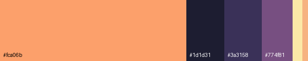

# Color Palette Decoder

[](https://github.com/humzagk/Color-Palette-Decoder/actions/workflows/tests.yml)

Extract the dominant colour palette of any image from the command line. You get hex codes ready to paste into a design tool, each colour's share of the image, and an optional swatch image. It runs locally, so you don't need to upload anything to an online palette generator.

| Input | Palette (`-n 6`) |
|---|---|
|  |  |

```
$ python color_palette_decoder.py examples/sunset.png -n 6 --swatch palette.png
#fca06b   60.5%
#1d1d31   12.4%
#3a3158   12.1%
#774f81   10.0%
#fce9a7    3.2%
#f6b381    1.8%
```

## How it works

1. **Downscale** the image to at most 200 px on its longest side. This is plenty for colour statistics and makes even 5K photos take about 0.2 s.
2. **Drop transparent pixels** so the empty areas of a PNG logo aren't counted as black.
3. **Quantise** with Pillow's fast octree algorithm. Photos contain thousands of slightly different shades, and counting exact RGB values just returns ten variations of the same colour. Quantising merges near-identical shades into clusters first.
4. **Rank** the clusters by the fraction of pixels they cover.

## Installation

Requires Python 3.11 or newer and Pillow.

```bash
git clone https://github.com/humzagk/Color-Palette-Decoder.git
cd Color-Palette-Decoder
pip install -r requirements.txt
```

## Usage

```bash
python color_palette_decoder.py IMAGE [-n COLORS] [--format hex|rgb|json] [--swatch PATH]
```

| Option | Description |
|---|---|
| `IMAGE` | Any image Pillow can open (JPEG, PNG, GIF, WebP, BMP, TIFF, ...) |
| `-n`, `--colors` | Number of colours to extract, 1-256 (default 6) |
| `--format` | `hex` (default), `rgb`, or `json` |
| `--swatch PATH` | Also save a 600×120 palette strip, with segments sized by share |

JSON output is handy for scripts:

```bash
python color_palette_decoder.py photo.jpg -n 3 --format json
```

```
[
  {
    "hex": "#6c99dc",
    "rgb": [108, 153, 220],
    "share": 0.5293
  },
  ...
]
```

### As a library

```python
from PIL import Image
from color_palette_decoder import extract_palette, to_hex

for rgb, share in extract_palette(Image.open("photo.jpg"), n_colors=5):
    print(to_hex(rgb), f"{share:.0%}")
```

## Tests

```bash
python -m unittest discover -s tests -v
```

The tests check that:

- a noisy image of 4 flat colours gives exactly 4 entries, each near its true colour
- shares reflect each colour's area and add up to 1
- transparent pixels are ignored
- images with fewer unique colours than requested are handled
- the CLI output formats and swatch are correct

## License

[MIT](LICENSE)
